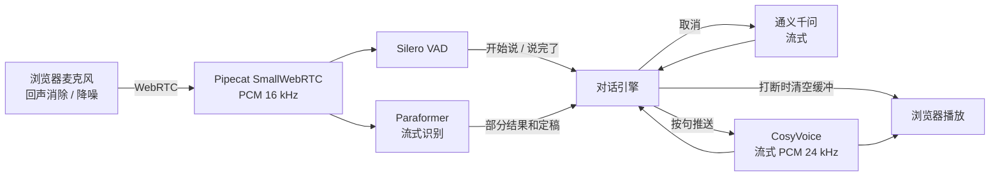
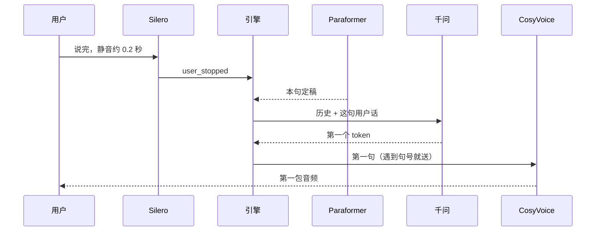

# 智语外呼

浏览器里的实时语音客服，第一版。打开网页，点「开始通话」，对着麦克风说中文。声音经 WebRTC 进 Python 服务，走 **流式识别 → 大模型 → 流式合成**，回复在网页里播放。你在客服说话时开口，播放会停，正在生成的文字和音频也会取消。

场景是虚构的「星河大学图书馆」：助手小语打电话确认预约的书到馆了。这是竞赛演示，不索要验证码、密码或银行卡。

## 为什么用这套

| 选择 | 原因 |
| --- | --- |
| Pipecat 的 SmallWebRTC | 媒体在 Python 进程里用 aiortc 收发，不需要再装 LiveKit 或 Daily 这类媒体服务器。竞赛机器用一个容器就能演示。 |
| 对话逻辑自己写 | Pipecat 自带整条语音管线，但打断、耗时和供应商切换会散落在框架里。v1 把这三件事放在 `ConversationEngine`，单测用假的识别、模型和合成就能跑。Pipecat 只负责把浏览器的声音送进来、把合成的声音送出去。 |
| Silero VAD | 本地、CPU、毫秒级。用来判断「开始说」和「说完了」，不把这件延迟敏感的事交给云端。 |
| 阿里云百炼 DashScope | 团队在国内。一把密钥就能用通义千问、Paraformer 实时识别和 CosyVoice。千问走 OpenAI 兼容接口，识别和合成走文档里的 WebSocket，不绑死某个 SDK 版本。 |

换供应商时只改 `zhiyu/providers/`，让新类满足 `base.py` 里的三个接口，再改 `factory.py`。引擎和网页不用动。

## 架构



一次正常的回复：



采样率固定成两段，避免各说各话：麦克风进服务后重采样到 **16 kHz**（Silero 和 Paraformer 都吃这个），合成输出 **24 kHz**（`longxiaochun_v2` 支持，也是 Pipecat 播放端的默认值）。

## 每一级在做什么

1. **浏览器** `zhiyu/static/app.js`  
   `getUserMedia` 显式打开 `echoCancellation`、`noiseSuppression`、`autoGainControl`。然后用网页里的 `RTCPeerConnection` 把 SDP 发到 `POST /api/offer`，后续 ICE 候选走 `PATCH /api/offer`。没有引入前端框架。

2. **WebRTC** `zhiyu/transport/bot.py`  
   Pipecat 的 `SmallWebRTCTransport` 把 Opus 解成 PCM。管线只有三段：输入 → `VoiceSessionProcessor` → 输出。

3. **VAD** `zhiyu/pipeline/vad_bridge.py`  
   Silero 有四个状态。只有变成 `SPEAKING` 才算用户开口，回到 `QUIET` 才算说完。咳嗽停在 `STARTING`，不会把客服打断。

4. **识别** `zhiyu/providers/dashscope_asr.py`  
   一整通电话一条 WebSocket。音频持续上传，服务端用 `result-generated` 回当前句的文本。`sentence_end` 为真时是整句，不是增量。报文格式在 `providers/messages.py`，单测不联网。

5. **对话引擎** `zhiyu/pipeline/engine.py`  
   用户停说后最多再等 `ASR_FINALIZE_TIMEOUT`（默认 0.35 秒）收定稿。已经有定稿就立刻开始。大模型按 token 往外吐，`SentenceSplitter` 遇到句号、问号就切一句给 CosyVoice。CosyVoice 会把没写完的句子先攒着，所以必须我们自己先断句，第一句才能出声。

6. **大模型** `zhiyu/providers/dashscope_llm.py`  
   `AsyncOpenAI`，`base_url` 指向百炼的兼容接口，`stream=True`。

7. **合成** `zhiyu/providers/dashscope_tts.py`  
   每一轮回复一条 WebSocket：`run-task` → 若干 `continue-task` → `finish-task`。二进制帧就是 PCM。

8. **播放**  
   引擎把 PCM 包成 `OutputAudioRawFrame`。Pipecat 的输出端按 24 kHz 推进浏览器的音频轨道。

字幕和耗时不走音频通道。引擎把事件放进内存里的 `SessionHub`，网页每 400 毫秒轮询 `GET /api/sessions/{pc_id}`。

## 打断怎么做

用户一被 VAD 确认在说话，而客服还在生成或播放：

1. 引擎把 `_generation` 加一。旧任务每拿到一个字、一块音频都先看代号，对不上就丢掉。
2. 取消那个 `asyncio.Task`，卡在大模型或合成连接上的等待会退出。
3. 往输出端推 `InterruptionFrame`。Pipecat 把还没写进 WebRTC 的播放队列清掉。
4. 这句用户话等他说完，再当作新的一轮。

浏览器开了回声消除，是为了让客服自己的声音不要再被麦克风收进去、误当成用户插话。这是 v1 防止自问自答的主要办法。

开场白不经过大模型，接通后直接合成 `prompts/opening.txt`。开场白播放时插话，同样走上面的取消。

短暂停顿（VAD 已经说「说完了」，但回复还没开始）不会把已经识别的半句丢掉，用户继续说时拼回同一句。

## 耗时日志

每一轮结束打一行，单位毫秒。没有发生的阶段是 `-`。

```text
耗时 ASR定稿 40 ms | LLM首token 380 ms | TTS首包 290 ms | 端到端首包 710 ms | 打断=False | 用户=在的 | 客服=今天方便来取吗？
```

| 字段 | 从哪到哪 |
| --- | --- |
| ASR 定稿 | VAD 认为说完 → 引擎认定这句文本可以用 |
| LLM 首 token | 文本定稿 → 大模型第一个字 |
| TTS 首包 | 第一个字 → 第一块 PCM（开场白则从「开始合成」算） |
| 端到端首包 | VAD 认为说完 → 第一块 PCM |

目标是端到端首包大约 2 秒以内。预算大致是：静音确认 0.2 秒 + 等定稿最多 0.35 秒 + 千问首 token + CosyVoice 第一句。没有真实密钥时，这个数字没法在这里测出来。网页上「本轮耗时」和日志是同一组数。

## 人设和以后要加的东西

系统提示词在 `prompts/system_prompt.txt`，开场白在 `prompts/opening.txt`。换业务时先改这两个文件。

`zhiyu/extensions.py` 里有两个空钩子，引擎每轮都会调用：

- `prepare_messages`：发给大模型之前。以后在这里换状态机对应的提示词，或把检索到的资料插进消息。
- `after_turn`：这一轮结束，包括被打断的情况。以后在这里写结构化 JSON、出质检报告，或把样本送进评测。

v1 的大模型接口只产出文本。函数调用要同时改 `LanguageModel`，让它能返回工具名和参数。这里先留了说明，没有做。

## 如何获取 DashScope 密钥

1. 打开阿里云百炼控制台：<https://bailian.console.aliyun.com/>
2. 按文档创建 API Key：<https://help.aliyun.com/zh/model-studio/get-api-key>
3. 确认账号能调用这三个模型：`qwen-plus`、`paraformer-realtime-v2`、`cosyvoice-v2`（音色 `longxiaochun_v2`）。
4. 北京地域的 Key 配北京的地址。默认是：
   - 千问：`https://dashscope.aliyuncs.com/compatible-mode/v1`
   - 识别和合成：`wss://dashscope.aliyuncs.com/api-ws/v1/inference`
5. 如果控制台给了工作空间专属域名，把 `.env` 里的 `DASHSCOPE_BASE_URL` 和 `DASHSCOPE_WS_URL` 换成文档里的 `{WorkspaceId}.cn-beijing.maas.aliyuncs.com`。Key 和域名必须是同一个地域。

服务只检查变量是不是空的，不会在启动时拿密钥去联网试一次。密钥写错时，接通后页面上会看到识别或模型返回的错误。

## 本地运行

需要 Python 3.11 及以上。

```bash
python3 -m venv .venv
source .venv/bin/activate
pip install -r requirements-dev.txt
cp .env.example .env
# 编辑 .env，填上 DASHSCOPE_API_KEY
python -m zhiyu.server
```

浏览器打开 <http://localhost:7860> 。建议用 Chrome 或 Edge。第一次要点允许麦克风。

没有 `.env` 也可以启动。页面会说明缺 `DASHSCOPE_API_KEY`，这时点通话会被拒绝，避免连上一个什么都做不了的会话。

跑测试：

```bash
pytest
```

测试不访问百炼。打断、断句、报文格式、缺密钥时的接口都用假对象。

## Docker

```bash
cp .env.example .env
# 填好 DASHSCOPE_API_KEY
docker compose up --build
```

没有 `.env` 时 `docker compose up --build` 也会起来，页面同样提示缺密钥。

容器监听 `7860`。另外映射了 UDP `40000-40100`，并在 Linux 上把容器的临时端口收进这个区间。aiortc 不能自己指定端口，这是官方示例用的办法，好让别的机器上的浏览器连上媒体。

本机浏览器访问本机映射出来的 `localhost:7860` 时，通常用主机候选就能通，不依赖 STUN。浏览器和服务器不在同一网络时，国内默认用 `stun.qq.com` 和 `stun.miwifi.com`。`stun.l.google.com` 在大陆经常不可用。macOS 上的 Docker 往往还需要 TURN，本仓库没有带 TURN。

当前 Docker 若拒绝 `sysctls`，把 `docker-compose.yml` 里的 `sysctls` 段删掉再启动。同一台机器上的演示一般仍然可以通。

## 目录

```text
prompts/                 系统提示词和开场白
zhiyu/config.py          环境变量。缺密钥不会让进程退出
zhiyu/extensions.py      下一版的钩子
zhiyu/providers/         识别、千问、CosyVoice，以及报文
zhiyu/pipeline/engine.py 轮次、打断、耗时
zhiyu/pipeline/vad_bridge.py
zhiyu/transport/         Pipecat WebRTC 和处理器
zhiyu/server.py          网页、/api/status、/api/offer
zhiyu/static/            页面
tests/                   不联网的单测
```

## 下一步

按竞赛题目，后面这些还没做，钩子的位置已经留好：

- 状态机：开场、确认是否方便、记录到馆时间、结束。不同状态换不同提示词，改 `prepare_messages`。
- RAG：把图书馆规则检索出来，插进同一处。
- 函数调用：例如「记下取书时间」。要扩展 `LanguageModel`，不要把 JSON 从回复文本里硬切。
- 通话结束写回结构化 JSON，并生成一份质检报告：用 `after_turn` 积累，挂断时汇总。
- 自评测：固定一组用户语音或文本，看打断是否及时、有没有索要敏感信息、首包延迟是否还在 2 秒左右。
- 真正的电话外呼：接运营商 SIP。届时媒体入口可以换成别的 Pipecat Transport，引擎保持不动。
- 服务端回声消除：浏览器的回声消除在耳机或外放很响时可能不够。

## 已知限制

- 没有 DashScope 密钥时，只能验证页面、缺密钥提示、Docker 镜像和单测，不能验证真实首包延迟。
- 识别按「当前句全文」来拼接。如果百炼以后改成增量字段，要改 `ConversationEngine.on_transcript`。
- 进程内的通话记录不落盘，重启就没了。
- 打断之后，浏览器里已经进入抖动缓冲的几十到一两百毫秒音频，服务端清不掉。
